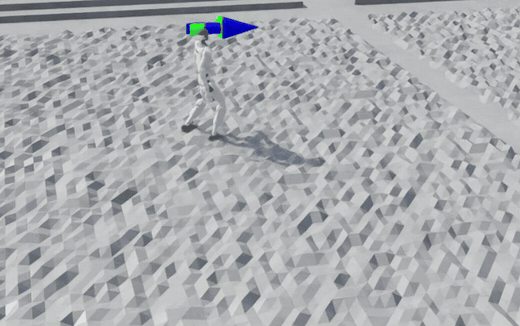
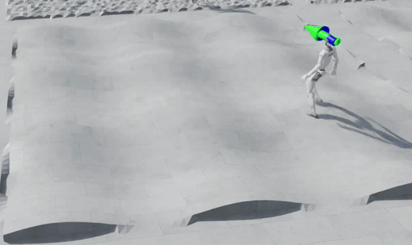
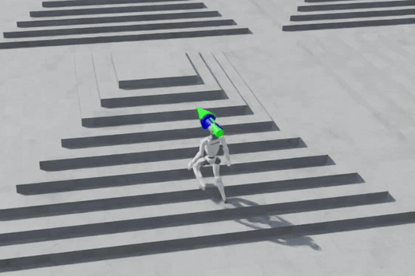
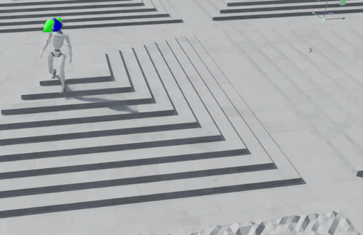

# Humanoid-DreamWaq

[English](README.md) | [简体中文](README.zh-CN.md)

**Blind locomotion on rough ground, waves, and stairs with a Unitree G1.**

This project adapts DreamWaQ's context estimator (CENet) and asymmetric actor–critic to the G1 29-DoF humanoid in Isaac Lab. It began with a height-scan-based PPO policy using Unitree RL Lab. To reduce dependence on potentially noisy or occluded external perception during sim-to-real transfer, the actor's height scan was removed and replaced with a learned context estimator driven by proprioceptive history.

## Simulation demos

The GIFs are excerpts from a checkpoint playback recorded on June 3, 2026. The training terrain also includes flat ground.

| Rough ground | Waves |
| :---: | :---: |
|  |  |
| **Stair ascent** | **Stair descent** |
|  |  |

**Known limitation.** During ascent, one foot often leads and the other joins it on the same step. Experiments with foot-placement and contact-duration rewards, and left-right mirror training, did not yield reliable alternating stair ascent. Results are simulation-only; real-robot deployment has not been validated. See the [training notes (Chinese)](docs/training_experience.md).

## Policy and observations

| Component | Inputs and role |
| --- | --- |
| CENet | Encodes five steps of proprioceptive history (480 dimensions) to estimate body linear velocity and a 16-dimensional latent context. |
| Actor | Maps a 96-dimensional history slice, estimated velocity, and latent mean to 29 joint-position actions. Proprioceptive inputs include body angular velocity, projected gravity, velocity commands, joint positions and velocities, and previous actions. |
| Critic | Uses one step of observations, including privileged simulated body linear velocity, height scan, and external force. Height scans also support some training rewards. |
| PPO | Jointly optimizes the policy and CENet using velocity supervision, reconstruction, and KL regularization. Simulation runs at 5 ms per step with a control decimation of four (50 Hz policy). |

**Checkpoint compatibility.** Isaac Lab flattens the history of each observation term separately before concatenation. The saved actor uses the last 96 elements of the resulting 480-dimensional vector; the decoder target uses the corresponding slice at the next control step. This slice spans multiple historical steps rather than representing a complete current frame as in DreamWaQ. The repository preserves this layout for checkpoint compatibility. The experimental mirror implementation assumes frame-major history; interpret the symmetry experiments with this limitation in mind.

## Installation

Use Linux, an NVIDIA GPU supported by Isaac Sim, Python 3.11, Isaac Sim 5.1, [Isaac Lab 2.3.2 at commit `d94504bcf`](https://github.com/isaac-sim/IsaacLab/commit/d94504bcf91cb7ab7ff956a2d48ecd1bca82797a), and RSL-RL 5.0.1. Isaac Lab is installed separately. See the [Isaac Lab installation guide](https://isaac-sim.github.io/IsaacLab/v2.3.2/source/setup/installation/index.html).

From the repository root, with `ISAAC_SIM_DIR` pointing to an installed Isaac Sim binary directory:

```bash
git clone https://github.com/isaac-sim/IsaacLab.git ../IsaacLab
git -C ../IsaacLab checkout d94504bcf91cb7ab7ff956a2d48ecd1bca82797a
ln -s "$ISAAC_SIM_DIR" ../IsaacLab/_isaac_sim
../IsaacLab/isaaclab.sh --conda humanoid-dreamwaq
conda activate humanoid-dreamwaq
../IsaacLab/isaaclab.sh --install rsl_rl
python -m pip install -e .
```

If a matching Isaac Lab environment already exists, activate it and install this package with `python -m pip install -e .`.

Download the official G1 29-DoF USD and its sublayers. The default asset directory is `assets/unitree_model`; set `UNITREE_MODEL_DIR` to use an existing Unitree model directory instead. Scene materials and HDR sky assets use Isaac Lab / Isaac Sim online resources.

```bash
python -m pip install huggingface_hub
hf download unitreerobotics/unitree_model --repo-type dataset \
  --include 'G1/29dof/usd/g1_29dof_rev_1_0/**' \
  --local-dir assets/unitree_model
python scripts/list_envs.py
```

## Playback and training

Play the included [CENet checkpoint](checkpoints/README.md) on mixed terrain. Terrain columns and initial robot positions depend on the configuration and random seed.

```bash
python scripts/play.py --terrain complex --num_envs 32 \
  --checkpoint checkpoints/g1_dreamwaq_82800.pt
```

Train from scratch on flat and wave terrain, or resume an existing CENet checkpoint for easy-stair fine-tuning:

```bash
python scripts/train.py --headless --terrain walk --num_envs 1024

python scripts/train.py --headless --terrain stairs --num_envs 1024 \
  --resume --checkpoint checkpoints/g1_dreamwaq_82800.pt
```

Other terrain presets are `stairs-medium` (moderate stairs and waves), `complex` (mixed challenging terrain), and `stable` (reduced-difficulty mixed terrain). The default task is `Unitree-G1-29dof-Velocity-CE`. Use `--task` to select another task.

| Task ID | Purpose |
| --- | --- |
| `Unitree-G1-29dof-Velocity-CE` | Main blind locomotion task |
| `Unitree-G1-29dof-Velocity` | Retained plain PPO entry point using the current proprioceptive actor observations |
| `Unitree-G1-29dof-Velocity-CE-Sym` | Mirror loss and foot-placement experiments |
| `Unitree-G1-29dof-Velocity-CE-Sym-Stairs` | Stair-only gait diagnostics |

Training outputs are written to `logs/rsl_rl/`. For a short playback check, add `--headless --max-steps 24`; use `--video` to record a rollout. See the [deployment notes (Chinese)](docs/sim_to_real_deployment_guide.md) for real-robot interface constraints and remaining validation steps.

## Repository layout

| Path | Contents |
| --- | --- |
| [`src/humanoid_dreamwaq/locomotion/`](src/humanoid_dreamwaq/locomotion/) | Task registration, terrain and environment configuration, CENet, PPO, and reward functions |
| [`src/humanoid_dreamwaq/assets/g1.py`](src/humanoid_dreamwaq/assets/g1.py) | G1 USD, joint, and actuator configuration |
| [`scripts/`](scripts/) | Task listing, training, and playback |
| [`checkpoints/`](checkpoints/) | Playback checkpoint and provenance |
| [`docs/`](docs/) | Demo GIFs and historical project notes |

## Credits and license

Built on [Unitree RL Lab](https://github.com/unitreerobotics/unitree_rl_lab), [Isaac Lab](https://github.com/isaac-sim/IsaacLab), and [RSL-RL](https://github.com/leggedrobotics/rsl_rl). The method is inspired by Nahrendra, Yu, and Myung's [DreamWaQ paper](https://arxiv.org/abs/2301.10602). See [LICENSE](LICENSE) and the [Isaac Lab license](docs/licenses/isaaclab-license.txt) for source licensing and upstream notices. Robot assets are supplied by the [official Unitree asset repository](https://huggingface.co/datasets/unitreerobotics/unitree_model/tree/main/G1/29dof).
