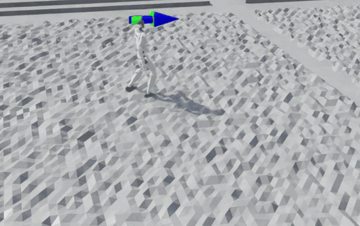
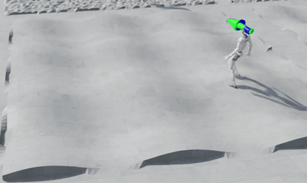
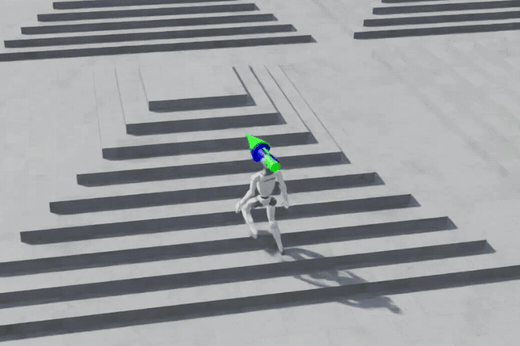
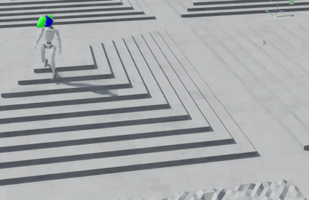

# Humanoid-DreamWaq

[English](README.md) | [简体中文](README.zh-CN.md)

**Unitree G1 人形机器人在粗糙地面、波浪地面和楼梯上的无外部感知行走。**

本项目在 Isaac Lab 中将 DreamWaQ 的上下文估计器与非对称 Actor–Critic 适配到 G1 29 自由度人形机器人。策略仅依赖本体感知历史完成仿真中的混合地形行走，上楼仍存在并步步态。

项目首先在 Unitree RL Lab 框架上训练了使用高度扫描的 PPO 策略，在仿真中实现了复杂地形行走。考虑到真实地形扫描可能受噪声和遮挡影响，随后移除了 Actor 的高度扫描输入，引入 DreamWaQ 的上下文估计网络（CENet）。结项策略在 Isaac Sim 中展示了粗糙地面、波浪地面和上下楼梯的速度跟踪。

## 仿真演示

动图来自 2026 年 6 月 3 日的 checkpoint 回放录屏。训练地形也包含平地。

| 粗糙地面 | 波浪地面 |
| :---: | :---: |
|  |  |
| **上楼梯** | **下楼梯** |
|  |  |

**步态限制。** 上楼时经常由一只脚先上台阶，另一只脚随后并到同一级。项目试验了落脚间距、左右脚接触时长等步态奖励，以及左右镜像训练，仍未得到稳定的左右交替上楼步态。验证范围为 Isaac Sim 仿真。逐次实验见[训练记录](docs/training_experience.md)。

## 策略与观测

| 模块 | 输入与作用 |
| --- | --- |
| CENet | 读取 5 帧本体观测（共 480 维），估计机体线速度和 16 维地形上下文 |
| Actor | 使用本体历史中的 96 维切片、估计速度与上下文均值，输出 29 个关节位置动作。观测包括机体角速度、投影重力、速度指令、关节位置与速度、上一控制步动作 |
| Critic | 使用一帧观测。真实机体线速度、高度扫描和外力用于训练，地形扫描也供部分奖励计算使用 |
| PPO | 联合优化速度跟踪与 CENet 的速度监督、重建和 KL 损失。仿真步长 5 ms，每 4 个仿真步执行一次策略（50 Hz） |

Isaac Lab 按观测项各自展平历史，再拼接为 480 维向量。现有 checkpoint 的 Actor 直接使用末尾 96 维做策略输入的一部分，重建目标也取下一控制步的相同切片。这个切片在当前布局下跨越多个历史时刻，与 DreamWaQ 论文使用的完整当前帧不同。回放保留此输入布局。镜像诊断代码使用了整帧排列的假设，镜像实验记录应结合这一实现限制解读。

## 安装

使用 Linux、支持 Isaac Sim 的 NVIDIA GPU、Python 3.11 和 Isaac Sim 5.1。项目依赖的 Isaac Lab 源码版本为 [2.3.2 的 `d94504bcf` 提交](https://github.com/isaac-sim/IsaacLab/commit/d94504bcf91cb7ab7ff956a2d48ecd1bca82797a)，RSL-RL 使用 `5.0.1`。Isaac Lab 与本项目分别安装。二进制 Isaac Sim 与 Conda 的配置步骤见 [Isaac Lab 安装文档](https://isaac-sim.github.io/IsaacLab/v2.3.2/source/setup/installation/index.html)。

在拥有 Isaac Sim 5.1 的机器上，从本项目根目录执行以下命令。把 `ISAAC_SIM_DIR` 设为 Isaac Sim 二进制安装目录。已有匹配版本的 Isaac Lab 环境时，激活该环境后直接执行 `python -m pip install -e .`。

```bash
git clone https://github.com/isaac-sim/IsaacLab.git ../IsaacLab
git -C ../IsaacLab checkout d94504bcf91cb7ab7ff956a2d48ecd1bca82797a
ln -s "$ISAAC_SIM_DIR" ../IsaacLab/_isaac_sim
../IsaacLab/isaaclab.sh --conda humanoid-dreamwaq
conda activate humanoid-dreamwaq
../IsaacLab/isaaclab.sh --install rsl_rl
python -m pip install -e .
```

下载 Unitree 官方 G1 29-DoF USD 及子图层。项目默认从 `assets/unitree_model` 查找，也可把 `UNITREE_MODEL_DIR` 指向已有的 Unitree 模型目录。仿真场景的材质和 HDR 天空使用 Isaac Lab / Isaac Sim 的在线资源。

```bash
python -m pip install huggingface_hub
hf download unitreerobotics/unitree_model --repo-type dataset \
  --include 'G1/29dof/usd/g1_29dof_rev_1_0/**' \
  --local-dir assets/unitree_model
python scripts/list_envs.py
```

## 回放与训练

使用附带的 [CENet checkpoint](checkpoints/README.md) 在混合地形上回放。窗口中的地形列和机器人起始位置由仿真配置和随机种子决定。

```bash
python scripts/play.py --terrain stable --num_envs 32 \
  --checkpoint checkpoints/g1_dreamwaq_102000.pt
```

从平地和波浪地形开始训练，或者从已有 CENet checkpoint 继续在简单楼梯微调。

```bash
python scripts/train.py --headless --terrain walk --num_envs 1024

python scripts/train.py --headless --terrain stairs --num_envs 1024 \
  --resume --checkpoint checkpoints/g1_dreamwaq_102000.pt
```

`--terrain` 还支持 `stairs-medium`（中等台阶和波浪）、`complex`（复杂混合地形）和 `stable`（降低难度的混合地形）。默认任务是 `Unitree-G1-29dof-Velocity-CE`。以下任务可通过 `--task` 选择。

| 任务 ID | 用途 |
| --- | --- |
| `Unitree-G1-29dof-Velocity-CE` | 盲行走主任务 |
| `Unitree-G1-29dof-Velocity` | 保留的普通 PPO 入口，使用当前本体 Actor 观测 |
| `Unitree-G1-29dof-Velocity-CE-Sym` | 镜像损失与落脚奖励实验 |
| `Unitree-G1-29dof-Velocity-CE-Sym-Stairs` | 纯楼梯步态诊断 |

训练输出位于 `logs/rsl_rl/`。回放可用 `--headless --max-steps 24` 做步进检查，或用 `--video` 保存录像。真机端的接口约束和待验证事项见[部署笔记](docs/sim_to_real_deployment_guide.md)。

## 仓库结构

- [`src/humanoid_dreamwaq/locomotion/`](src/humanoid_dreamwaq/locomotion/) 保存环境、地形、奖励、CENet 与 PPO 扩展。
- [`src/humanoid_dreamwaq/assets/g1.py`](src/humanoid_dreamwaq/assets/g1.py) 保存 G1 29-DoF 的 USD、关节和驱动器配置。
- [`scripts/`](scripts/) 提供任务列表、训练和回放入口。

- [`checkpoints/`](checkpoints/) 保存回放权重及其来源说明。
- [`docs/`](docs/) 保存演示动图及历史项目笔记。

## 来源与许可证

项目基于 [Unitree RL Lab](https://github.com/unitreerobotics/unitree_rl_lab)，仿真与训练使用 [Isaac Lab](https://github.com/isaac-sim/IsaacLab) 和 [RSL-RL](https://github.com/leggedrobotics/rsl_rl)。方法参考 Nahrendra、Yu 与 Myung 的 [DreamWaQ 论文](https://arxiv.org/abs/2301.10602)。源码许可证与上游声明见 [LICENSE](LICENSE) 和 [Isaac Lab 许可证](docs/licenses/isaaclab-license.txt)。模型资产由 [Unitree 官方资产库](https://huggingface.co/datasets/unitreerobotics/unitree_model/tree/main/G1/29dof) 提供。
